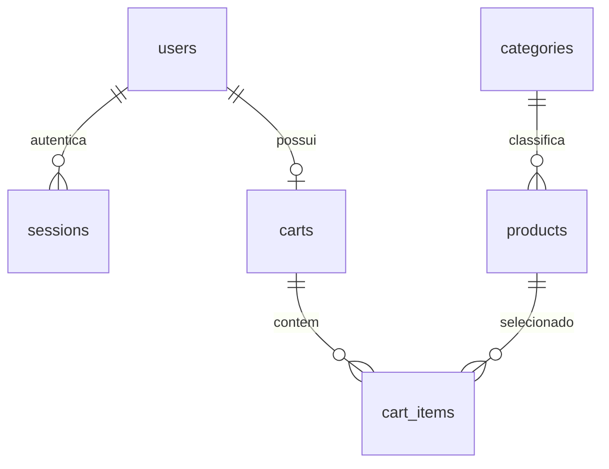
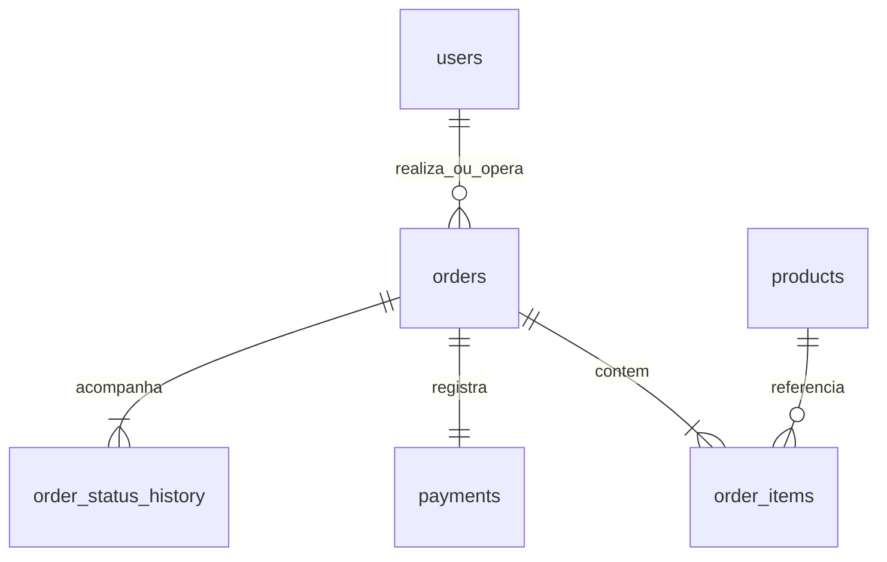
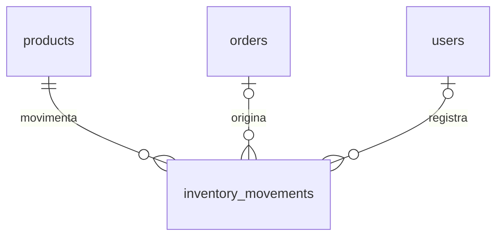

# Modelo do banco de dados

O banco de referência é PostgreSQL 17. A criação completa e reproduzível está em `database/migrations/001_initial.sql`, com dados de referência em `002_categories.sql`. `npm run db:migrate` aplica as migrações em ordem, em uma transação, com trava consultiva para impedir duas instâncias de migrar ao mesmo tempo. A tabela `schema_migrations` registra nome, SHA-256 e data; uma migração aplicada não pode ser alterada silenciosamente.

## Entidades

| Tabela | Finalidade | Chaves e vínculos |
| --- | --- | --- |
| `users` | Cadastro, hash de senha e perfil de acesso | PK `id`; `email` único e normalizado |
| `sessions` | Sessões autenticadas, CSRF e expiração | PK `token_hash`; FK `user_id` |
| `categories` | Classificação dos produtos | PK `id`; nome único |
| `products` | Dados do produto, preço, estoque físico, reserva e mínimo | PK `id`; FK `category_id`; barcode único quando preenchido |
| `carts` | Um carrinho persistente por usuário | PK e FK `user_id` |
| `cart_items` | Quantidade desejada de cada produto | PK composta `(user_id, product_id)`; FKs para carrinho e produto |
| `orders` | Pedido online ou venda presencial | PK UUID `id`; código público único; FK `user_id`; chave idempotente única por usuário |
| `order_items` | Produtos vendidos, quantidade e preço histórico | PK `id`; FKs `order_id`, `product_id`; único por pedido e produto |
| `payments` | Método, provedor, valor e estado do pagamento | PK UUID; FK `order_id` única, relação 1:1 |
| `inventory_movements` | Histórico de entradas, reservas, vendas e liberações | PK `id`; FKs para produto, pedido e usuário responsável |
| `order_status_history` | Transições de estado e usuário responsável | PK `id`; FKs para pedido e usuário |
| `schema_migrations` | Controle técnico das versões SQL | PK nome da migração |

`users` tem três perfis: `cliente`, `funcionario` e `admin`. A propriedade `user_id` do pedido representa o cliente no canal online e o operador no PDV. A venda presencial registra `customer_name = Cliente Balcão`, sem criar uma conta fictícia de comprador.

O cadastro de entrega é armazenado como snapshot JSONB em `orders.delivery_address`, com nome, e-mail, telefone, CEP, logradouro, número, complemento, cidade e UF validados na API. A entrega preserva o endereço utilizado em cada pedido, mesmo se o cadastro do cliente mudar. Não há uma agenda independente de endereços nesta versão.

## Relacionamentos







## Tipos e integridade

- **Dinheiro:** `price_cents` e `unit_price_cents` são inteiros; totais e subtotais são `bigint`. R$ 19,90 é armazenado como 1990. A API converte para reais na resposta e calcula o total no servidor. O subtotal do item é uma coluna gerada pelo PostgreSQL.
- **Estoque:** `stock` é físico, `reserved_stock` é a reserva e a quantidade disponível é a diferença. Há checks impedindo saldo negativo ou reserva maior que o estoque. As telas de estoque mostram os dois valores.
- **Identificação:** produtos, usuários e linhas usam identidades inteiras; pedidos/pagamentos usam UUID. O código público tem prefixo `KNG-` ou `PDV-` e é independente da identificação do cliente.
- **Barcodes:** são texto para preservar zeros iniciais; um código não pode identificar dois produtos. Quando não informado, é `NULL` no banco.
- **Datas:** eventos usam `timestamptz`. Relatórios agrupam a data de confirmação pelo fuso `America/Sao_Paulo`.
- **Histórico:** produtos são desativados, sem exclusão física. Os itens guardam `product_snapshot` e preço; relações com vendas não são apagadas em cascata. Exclusão de sessão/carrinho em cascata só se aplica ao usuário, que também não pode ser excluído enquanto tiver vendas vinculadas.
- **Quantidades:** linhas de carrinho e pedido aceitam inteiros de 1 a 999. A API permite 0 na atualização do carrinho apenas para remover o item. Estoque físico e mínimo são limitados a 1.000.000 de unidades por produto.
- **Atualização:** triggers mantêm `updated_at` nas entidades editáveis. Histórico de estoque e de status é escrito explicitamente pela camada de serviço dentro da transação da operação.

## Transações de venda

O carrinho não reserva estoque. No checkout, a API serializa as alterações por usuário com `pg_advisory_xact_lock`, procura uma venda anterior com a mesma chave de requisição e trava as linhas de produto com `SELECT ... FOR UPDATE`, em ordem de ID. Valida se todos estão ativos, se há saldo e calcula o total a partir dos preços armazenados.

Depois, na mesma transação, cria pedido, itens, pagamento, reservas, movimentações e histórico, e esvazia o carrinho. Se qualquer etapa falhar, nada é confirmado. A confirmação do pagamento trava o pedido e os mesmos produtos, baixa o físico e a reserva uma única vez e marca pedido/pagamento como pagos. Repetir a confirmação retorna o pedido sem nova baixa.

No PDV, a venda já nasce paga e entregue, com baixa direta do físico. A requisição deve conter a chave UUID `Idempotency-Key`. Repetir chave e conteúdo retorna a mesma venda; reutilizar a chave com conteúdo diferente retorna 409. A aplicação deve reutilizar a chave após uma falha de conexão cujo resultado seja desconhecido.

A reserva pendente é cancelável e expira em 30 minutos. O processo de limpeza trabalha um pedido por transação e ignora pedidos já travados por outro processo. Os status logísticos só avançam na sequência e após pagamento.

As credenciais do banco permitem executar SQL diretamente. As regras de fluxo de pagamento, autorização, total do pedido e histórico dependem da API; não são triggers que substituem a camada de aplicação. O banco também aplica suas restrições de chaves, unicidade e checks.

## Consultas para apresentação

```sql
-- Estoque físico, reservado, disponível e alerta.
SELECT id, name, stock AS fisico, reserved_stock AS reservado,
       stock - reserved_stock AS disponivel, min_stock,
       stock - reserved_stock <= min_stock AS precisa_repor
FROM products WHERE active ORDER BY name;

-- Itens com valores históricos da compra.
SELECT o.code, i.product_snapshot->>'name' AS produto,
       i.quantity, i.unit_price_cents / 100.0 AS preco,
       i.subtotal_cents / 100.0 AS subtotal
FROM orders o JOIN order_items i ON i.order_id = o.id
ORDER BY o.created_at DESC, i.id;

-- Histórico de um produto (substitua 1 pelo ID desejado).
SELECT kind, stock_delta, reserved_delta, stock_after, reserved_after, reason, created_at
FROM inventory_movements WHERE product_id = 1 ORDER BY id;

-- Conferência do ledger com o saldo armazenado.
SELECT p.id, p.name, p.stock, p.reserved_stock,
       coalesce(sum(m.stock_delta), 0) AS saldo_historico,
       coalesce(sum(m.reserved_delta), 0) AS reserva_historica
FROM products p LEFT JOIN inventory_movements m ON m.product_id = p.id
GROUP BY p.id ORDER BY p.id;
```

O seed carrega produtos e usuários demonstrativos, com hashes gerados no momento da execução. Nenhum pedido de venda antigo do protótipo é importado como transação real. O primeiro relatório de uma instalação nova começa zerado.
